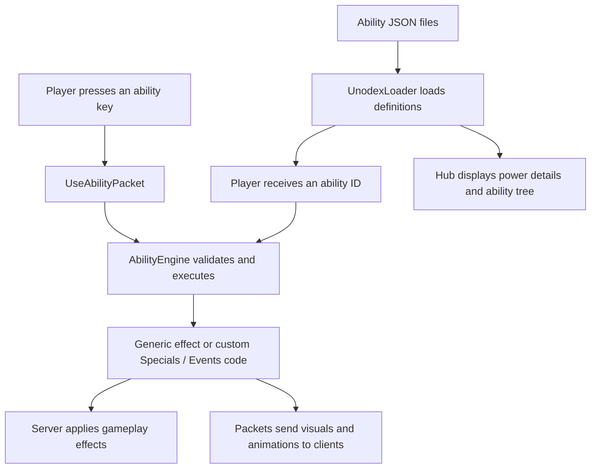

# Ability development: code, moves, animations and integration

An ability combines **JSON definitions**, a **shared Java engine**, and, when needed, **custom Java behavior**. Start with the JSON: changing costs, cooldowns, existing effects and prerequisites usually does not require Java changes.

Paths in this guide are relative to `unrp-forge/`. All custom resource IDs use the `unrp` namespace.

## Where everything lives

| What you want to change | File / directory |
| --- | --- |
| Power definitions, attacks, costs, cooldowns and prerequisites | [ability_powers.json](../src/main/resources/data/unrp/unodex/ability_powers.json) |
| Names, descriptions and ability catalogue information | [abilities.json](../src/main/resources/data/unrp/unodex/abilities.json) |
| Roll eligibility and relative weights | [ability_pool.json](../src/main/resources/data/unrp/unodex/ability_pool.json) |
| Starting stat-potential ranges | [stat_ranges.json](../src/main/resources/data/unrp/unodex/stat_ranges.json) |
| Character-to-ability assignments (`ability_id`) | [characters/](../src/main/resources/data/unrp/unodex/characters/) |
| Supported power and move fields | [AbilityPower.java](../src/main/java/com/myriam/unrp/data/AbilityPower.java) |
| Loading JSON and resolving IDs / aliases | [UnodexLoader.java](../src/main/java/com/myriam/unrp/data/UnodexLoader.java), [UnodexData.java](../src/main/java/com/myriam/unrp/data/UnodexData.java) |
| Activation, inputs, aura, cooldowns and generic gameplay effects | [AbilityEngine.java](../src/main/java/com/myriam/unrp/ability/AbilityEngine.java) |
| Ability-specific behavior | [Specials.java](../src/main/java/com/myriam/unrp/ability/Specials.java), its numbered companion files in [ability/](../src/main/java/com/myriam/unrp/ability/), and event classes in [uo/](../src/main/java/com/myriam/unrp/uo/) |
| Prerequisites, rank purchases and mastery requirements | [Unlocks.java](../src/main/java/com/myriam/unrp/ability/Unlocks.java) |
| Server-side effects sent to nearby clients | [Fx.java](../src/main/java/com/myriam/unrp/ability/Fx.java) |
| Client-side effect rendering | [FxRenderer.java](../src/main/java/com/myriam/unrp/client/FxRenderer.java), [FxParticle.java](../src/main/java/com/myriam/unrp/client/FxParticle.java) |
| Shared projectile behavior | [Projectiles.java](../src/main/java/com/myriam/unrp/ability/Projectiles.java) |
| Textures, models, geometry, animations and sounds | [assets/unrp/](../src/main/resources/assets/unrp/) |

The [POWERS.md reference](POWERS.md) describes many JSON fields, effect kinds and examples. Some older key descriptions are historical; the current key bindings and code are authoritative.

## How the parts connect



1. `UnodexLoader` loads the catalogue, power definitions, aliases, roll pool and stat ranges into `UnodexData`.
2. A claimed character uses its `ability_id`; an OC receives an ability through the roll or an admin assignment. An alias can map several catalogue IDs to the same power definition.
3. [AbilityBar.java](../src/main/java/com/myriam/unrp/look/AbilityBar.java) handles the current ability-bar input using Palladium key bindings and sends [UseAbilityPacket](../src/main/java/com/myriam/unrp/net/UseAbilityPacket.java).
4. `AbilityEngine.input()` runs on the server. It checks the player's state, available aura, cooldowns and unlocks, and handles press/release, held, toggle and charge inputs.
5. `AbilityEngine.perform()` selects custom behavior through `special`, or executes an existing generic effect through `fx`. Some moves use trigger/hold tags consumed by event classes instead.
6. The server applies gameplay effects and sends visual/animation packets. Clients draw the effects and animate the character.
7. [PlayerStateService](../src/main/java/com/myriam/unrp/player/PlayerStateService.java) and [SocialService](../src/main/java/com/myriam/unrp/social/SocialService.java) supply the HUD and hub with current state. [HubScreen](../src/main/java/com/myriam/unrp/client/HubScreen.java) draws the Power radar and Abilities tree, using [HubGraphLayout](../src/main/java/com/myriam/unrp/client/HubGraphLayout.java) for geometry.

The **server** decides whether an attack or unlock is allowed and applies damage, aura costs and cooldowns. Client rendering does not grant an ability or bypass those checks.

## What “movements” means

| Meaning | Where to edit |
| --- | --- |
| An attack or skill | An entry in a power's `moves` array in `ability_powers.json`. |
| Moving the player through the world | Generic effects such as `dash` and `teleport` in `AbilityEngine.java`, or specialized ability/event code. |
| Animating the character's body | The move's `pose`, dispatched by [Poses.java](../src/main/java/com/myriam/unrp/ability/Poses.java), and the animation systems below. |

A move's `pose` controls its body animation; its `fx`, `special` or trigger tags control what it actually does. A pose alone does not implement an attack.

The [anim/ package](../src/main/java/com/myriam/unrp/anim/) contains the player animation system:

- [MoveClips.java](../src/main/java/com/myriam/unrp/anim/MoveClips.java): clip data and keyframes.
- [MoveClipIds.java](../src/main/java/com/myriam/unrp/anim/MoveClipIds.java): clip IDs and metadata used to resolve animations.
- [MoveAnim.java](../src/main/java/com/myriam/unrp/anim/MoveAnim.java): server-side animation playback and synchronization.
- [MoveAnimClient.java](../src/main/java/com/myriam/unrp/anim/MoveAnimClient.java): client playback and rendering integration.

Additional asset animations live in [assets/unrp/animations/](../src/main/resources/assets/unrp/animations/), with geometry in [geo/](../src/main/resources/assets/unrp/geo/). Use the animation system employed by the ability you are extending; player clips and model/entity animation assets are separate paths.

## Add an ability using existing mechanics

1. Choose a unique ID, such as `gold_bolt`. Add its catalogue entry to the `abilities` array in `abilities.json`. Copy a nearby entry and update its ID, name, description and relevant metadata.
2. Add the matching entry under `powers` in `ability_powers.json`. The following is an entry inside that object, not a replacement for the whole file:

   ```json
   "gold_bolt": {
     "icon": "unrp:textures/icons/gold_bolt.png",
     "look": {
       "style": "lightning",
       "color": "#F0C846"
     },
     "moves": [
       {
         "name": "Golden Bolt",
         "desc": "Launch a golden projectile.",
         "input": "action",
         "cost": 12,
         "cooldown": 40,
         "bar_slot": 1,
         "icon": "unrp:textures/icons/gold_bolt.png",
         "fx": {
           "kind": "bolt",
           "speed": 2.0,
           "life": 15,
           "dmg": 6,
           "particle": "electric_spark"
         }
       }
     ]
   }
   ```

3. Create the referenced icon at `src/main/resources/assets/unrp/textures/icons/gold_bolt.png`. Reusing an existing icon path is also possible.
4. Add an entry under `ranges` in `stat_ranges.json`. Each entry is five `[minimum, maximum]` pairs, in this order: **power, defense, recovery, trick, speed**. Copy a comparable ability and adjust its ranges.
5. If the ability should be rolled, add `"gold_bolt": <positive weight>` under `pool` in `ability_pool.json`. A weight is relative to the other eligible abilities, not a fixed percentage. Assignment-only abilities do not need a positive roll weight; the hard-coded `NOT_ROLLABLE` set in `UnodexData` also excludes its listed IDs.
6. Build and launch the updated mod. As an admin, assign it to an eligible OC:

   ```text
   /unrp giveability <player> gold_bolt
   ```

The command checks eligibility and ability uniqueness. A lifelong Cripple cannot receive an ability this way. To give a canon character the ability, change that character's `ability_id` instead.

**20 ticks = one second.** In this example, `cooldown: 40` is two seconds. Supported inputs include `action`, `held`, `toggle` and `charge`; use the matching fields described in `AbilityPower.Move` and `POWERS.md`.

## Add branches to the ability tree

Add more objects to the same `moves` array. For example, these fields on a later move mean it requires rank 3 and the first move to be unlocked:

```json
"unlock": 3,
"requires": 0
```

- `requires` is a **zero-based index into the same `moves` array**: `0` is the first move, `1` is the second. Omit it for no move prerequisite (default `-1`). Reordering moves requires updating their prerequisite indexes.
- `unlock` values 2, 3 and 4 use the existing rank purchases, costing `rank - 1` ability points. These purchases are shared across the player's powers; they are not a separate purchase for each tree node.
- `mastery: true` additionally requires full mastery under the current rules.
- `bar_slot` selects the ability-bar slot; it is separate from the zero-based prerequisite index. The system supports additional pages and stance-dependent moves.

`SocialService` sends the definitions and locked states to the hub; `HubScreen` draws the branches automatically. `Unlocks.locked()` and `Unlocks.buy()` enforce the requirements and purchases on the server. Clicking a node selects its details; the rank buttons perform the purchases.

## Add a completely new mechanic in Java

Use existing `fx` kinds when they already express the behavior. For a genuinely new mechanic:

1. Give the move a unique `special` string in its JSON definition.
2. Implement its gameplay behavior in an appropriate custom Java class.
3. Connect the identifier through `Specials.handles()` and the `Specials.run()` dispatch path (including the relevant numbered companion class, if used).
4. Add ticking, held/toggle updates, release handling and cleanup where the behavior needs them. Review the existing `whileOn` and `stop` paths, and cleanup when the player disables the power or leaves.
5. Add the necessary effects and animation calls separately. Keep gameplay validation and world mutations on the server.

An unknown `special` string alone does not implement behavior. For an event-driven mechanic, follow the existing trigger/tag pattern and register the required event handler as well. The [fidelity/](fidelity/) notes identify the classes used by individual existing powers.

## Visuals and assets

- `Fx.java` sends shared effect information; `client/FxRenderer.java` and `client/FxParticle.java` render it.
- Specialized effects also have their own renderers and packets in `uo/`, `pass/` and related packages. Follow the path already used by the power you are editing.
- Icons and particle sprites: [textures/icons/](../src/main/resources/assets/unrp/textures/icons/) and [textures/particle/](../src/main/resources/assets/unrp/textures/particle/).
- Models and geometry: [models/](../src/main/resources/assets/unrp/models/) and [geo/](../src/main/resources/assets/unrp/geo/).
- Sounds: [sounds/](../src/main/resources/assets/unrp/sounds/) and [sounds.json](../src/main/resources/assets/unrp/sounds.json).
- Other paths, GUI colors and texture-generation scripts: [where is what.md](where%20is%20what.md).

## Build and test changes

From `unrp-forge/`:

```bash
./gradlew build
./gradlew runClient
```

The distributable JAR is generated in `build/libs/`. Replace the installed JAR and restart Minecraft to test Java or packaged-resource changes.

`/reload` reloads server-side ability data from the resources/datapacks available to the running server. Editing a source JSON file does not by itself replace a resource already packaged in an installed JAR. For source development, rebuild/process the resources and restart as needed; for live data tuning, edit an overriding datapack and use `/reload`. Client textures and animations have a separate resource-reload lifecycle.

Check activation, press/release behavior, costs, cooldowns, prerequisites, stance changes and cleanup for the mechanic you changed. Watch the logs for ignored JSON files or missing resources.

The guide in `POWERS.md` also describes generator scripts. Avoid rerunning a generator with an overwrite/force option over hand-edited definitions unless that replacement is intended.
