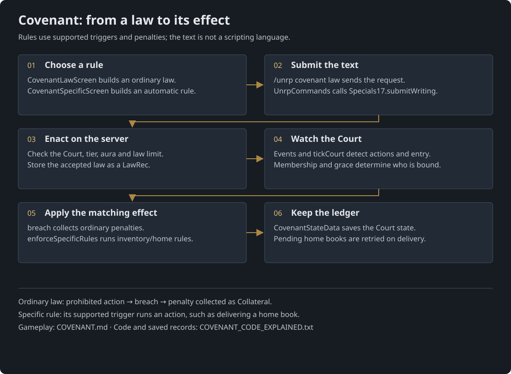

# Covenant

*Stepping into his court is signing his contract.*

The user is a **Sovereign**. Their range is their **Court**. Entrants sign its laws; breaking a law collects its penalty as **Collateral**. The gold seal, hand signatures, floating law text, private Pacts and readable Constitutions are part of its presentation.

This guide describes the implemented Minecraft version. The author's full design is preserved in [COVENANT_SPEC.md](COVENANT_SPEC.md). Earlier prototype thresholds and return rules are superseded by this document.

## Tier rules

The normal project tier boundaries apply to the character's actual level:

| Tier | Level | Court radius | Rules |
| --- | --- | --- | --- |
| Low | Below 2.0 | 10 m | Two laws; stat and movement penalties. Laws are publicly announced in chat. People already inside get three seconds to read a new law; later entrants are bound immediately. |
| Mid | 2.0–3.4 | 30 m | Five laws. Pact, Fine Print and Endowment become available. A Pact needs real consideration. Stat collateral returns one hour after Court closure. |
| Elite | 3.5–4.9 | 75 m | Unlimited laws. Foreclosure, Exile, Proxy and Appropriation; branch and sense penalties. Maximum five held branches; a branch from a higher-level victim returns after ten minutes. |
| High | 5.0–5.9 | 150 m | Memory and soul penalties; permanent building Courts; signature/debt registry and soul summoning. Pact souls persist. More than ten held souls impose a visible self-signature and one randomly chosen daily law without immunity. **Indemnity has no timer from 5.0 onward.** |
| God | 6.0+ | 500 m | Earlier tier restrictions are removed: no five-branch storage cap, no older collateral-return timers, no mandatory consideration for Pacts, no soul-count burden. Up to ten appropriated branches may be wielded simultaneously. |

God-tier restrictions that still apply: five Constitutions, a one-hour retroactive window confined to acts actually committed within the Court, one-week sight signatures, 24-hour jurisdiction, and one hour of Pact immunity after refusing a Sovereign Pact. Reaching God tier removes earlier return timers from collateral still held by that Sovereign.

Durations use server ticks at 20 ticks/second: one hour = 72,000 ticks, one day = 24 hours, one week = seven days. These clocks persist through saves and advance while the server world runs; they are not Minecraft daylight cycles and do not advance while the server is stopped.



## Claiming territory

At effective level **5.0+**, the Sovereign can claim a fixed area as a permanent Court. Activate Covenant, open Enact and click **Claim...**, or use `/unrp covenant claim Myriam Court` while standing at its centre. The command without a name opens the naming form.

The claim covers a horizontal radius of 150 blocks at High tier or 500 at God tier, across all heights in that dimension. Its boundary stays fixed after claiming. The personal Court's current laws and entry conditions are copied into it; later edits are independent. New laws target the claimed territory immediately after claiming it.

| Command | Use |
| --- | --- |
| `/unrp covenant territories` | List your claims, dimensions, centres and radii |
| `/unrp covenant territory Myriam Court` | Select your named territory for law editing |
| `/unrp covenant personal` | Return to editing your moving Court |
| `/unrp covenant unclaim Myriam Court` | Close and release your named territory |

Names are unique across Covenant claims. Claims cannot overlap another Covenant claim, including your own. Only their Sovereign can select or release them. Release remains available without activating the power. The territory and its laws survive saves, disconnects and closing the moving Court; they have no 24-hour expiry. Court closure rules handle Collateral when a claim is released.

These are ability territories, separate from school/King turf ownership. They enforce Covenant laws; they do not provide general block protection. God-tier **Jurisdiction** remains a separate, temporary 24-hour Court.

## Stances and controls

Assign the ability to an eligible OC with `/unrp giveability <player> covenant`. It remains assignment-only, excluded from the normal ability roll. Activate it with the configured power toggle. The main bar page contains the power toggle and four stance actions. Use the configured ability-list key (default X) to reach the second page, then press its Change Stance action. It has its own bar slot and does not replace Enact. Each stance has four actions.

| Stance | Moves / behavior |
| --- | --- |
| Legislation | **Enact**: opens a click-to-create law form; choose an action and a penalty, then press Enact. Crouch to repeal the latest law. **Terms of Entry**: next message selects confiscated item categories; crouch at High+ to seal a persistent building Court. **Fine Print**: hide one law; crouch to reveal it. **Foreclosure**: collect unpaid collateral plus 25% interest, rounded up; crouch for **Exile** after three breaches. |
| Contracts | **Pact**: offer a private agreement to the targeted signer, accepted/refused in chat; crouch at 5.0+ to summon a held soul. **Endowment**: lend a stat, branch or soul to an ally; crouch cycles collateral. Loans end on Court closure or the ally's breach. **Proxy**: transfer wounds to a signer until Court closure; crouch releases them. **Appropriation**: wield a stolen branch at its recorded original owner's strength, without granting unrelated moves or base-power passives. |
| Immunity | **Sovereign Immunity**: opt into/out of the user's own laws. **Indemnity**: cancel wounds and collect a breach from their author; six seconds below 5.0, permanent while the personal Court is active from 5.0, and press again to lift it. **Escrow**: cycle a protected stat; crouch cycles an available protected branch. **Arbitration**: suspend a debtor's ability until the debt is paid. |
| Constitution — God | **Constitution**: enter a law, or an existing law's number, to make it permanent for signed people inside and outside the Court. **Retroactive Law**: enter a law applied to recorded acts from the preceding hour. **Total Forfeit**: write a law with a whole-ability penalty. **Class Action**: collect one outstanding penalty from each debtor, including known offline signers. |
| Sovereignty — God | **Jurisdiction**: enter a registered territory name, or `here`, for a 24-hour autonomous Court. **Sovereign Pact**: offer a private agreement to a named person without a range restriction; known offline people receive it on reconnect. **Sovereign's Due**: set daily tribute. **Writing on the Hand**: send a private message to a marked signer at any distance; messages can wait for reconnect. |
| Registry | **Ledger**: list collateral and laws; the level-five passive adds debts and remaining resources, God adds locations and all recorded Pacts. **Return Collateral**: restore the selected item to its original owner. **Spend Collateral**: restore 20 aura while relinquishing the selected collateral and releasing its penalty. **Summon Soul**: summon the selected soul's online owner from any dimension. |

Drag empty space with the left mouse button, or drag anywhere with the right/middle button, to pan the ability tree. Scroll to move vertically; Ctrl + scroll zooms.

Use your current configured ability keys; the bar follows Palladium's key mappings. Caster and recipients do not need to stand together for God-tier marked-person actions. The named-target control below is available when aiming is impractical.

## Writing laws and Pacts

Activate Covenant with R, then press Enact. The law form opens: click the forbidden **Action**, choose its **Penalty**, then click **Enact**. Available penalties follow your tier. Nothing needs to be typed. A sentence preview shows the exact rule that will be sent to the server. Cancel/ESC also clears the pending law capture, so your next normal chat message is not accidentally treated as a law.

`/unrp covenant law` with no text also opens this form. **Advanced...** switches to the existing command prompt. Written commands still work directly, for example:

```text
/unrp covenant law No one may run. Penalty: their Speed
/unrp covenant terms Whoever enters gives up their weapons
```

These commands also work directly, without first pressing Enact and without a 30-second deadline. They require active Covenant and retain the same aura costs, tier restrictions and law caps. God-tier writing commands are `constitution`, `retroactive`, `forfeit`, `tribute`, `jurisdiction`, `message` and `sovereign_pact`, each followed by its text. `/unrp covenant cancel` clears a pending chat capture.


The advanced/legacy chat path for Enact, and the Terms/Pact/God-tier writing moves, can capture a chat message. Written inputs are parsed by explicit keywords, **not unrestricted natural-language reasoning**. Unrecognized laws or unavailable penalty types are rejected rather than silently invented.

Examples:

```text
No one may run. Penalty: their Speed
No jumping. Penalty: their Defense
No attacking. Penalty: branch 2
No flying. Penalty: hearing
No abilities. Penalty: whole ability
```

Supported violations: sprint/run, jump, attack, use an ability, speak, fly, break blocks, place blocks, crouch, leave the Court. Supported penalty categories: the five stats, sprint/jump/walk, branches, sight/touch/hearing, memory, souls, and God-tier whole abilities.

`branch 2` identifies the second original move. Named clauses such as `branch fire` / `your fire branch` match a move's name. The stance/mode switch itself is not stolen as a branch.

Terms of Entry accept weapons, armor, elytra, pearls or the whole inventory. Confiscated items are world-saved and returned when their Court closes, including when their owner reconnects later.

For a local Pact, aim at/select a signer and invoke Pact, then write:

```text
my life for your branch
my life for your Speed
```

At God tier a Sovereign Pact uses:

```text
PlayerName | nothing for your whole ability
PlayerName | my life for your soul
```

The target receives a private gold parchment and chat text. They answer `accept` / `yes`, or `refuse` / `no`. Declining a Sovereign Pact protects them from that Sovereign's Pacts for one hour. Accepted transfers and their contract records persist; the giver cannot cancel an accepted transfer as though it were an Endowment loan. The offer reserves its promised collateral, and both sides are validated before collection.

A Mid/Elite/High life offer must provide a real benefit (healing). God may offer `nothing`; it still cannot promise an unavailable named collateral item and silently substitute nothing. An ordinary unsigned offer lasts 30 seconds; a remote Sovereign offer can wait up to 24 server-running hours.

For a Constitution, enter either the full law or its existing number. It is readable on its author's gold body markings: aim at the author to read its complete text and penalty. The display rotates through their Constitutions. Only its author can repeal it.

Jurisdiction uses the boundaries of a named registered territory, or a 500 m district centered at the caster for `here`. It remains active for 24 hours without the caster, including after a save/restart. Separate named jurisdictions can be selected for later legislation.

Writing on the hand uses:

```text
PlayerName | Your debt has been settled.
```

## Collateral and targeting controls

These are normal chat messages interpreted privately, not slash commands:

```text
cv ledger
cv laws
cv target PlayerName
cv target clear
cv select 3
cv branch 2
cv return 3
cv pay
cv repeal 4
cv court 0
cv court 1
```

- `target` selects a person. Local actions still require Court membership; God can select a marked signer remotely. Clear the selection to use ordinary aiming.
- `select` chooses a collateral entry from the numbered ledger.
- `branch` chooses a usable branch to extract when appropriating collateral that contains an entire forfeited ability. Extraction still grants only that branch and counts toward the ten-branch wield limit.
- `pay` settles as much of your own outstanding debt as your available resources permit, including while Arbitration prevents ability use.
- `return` restores an entry to its original owner and removes any related loan/access.
- `repeal` removes one of the author's laws/Constitutions by ID.
- `court 0` edits the personal Court; positive numbers select a jurisdiction listed in the ledger.

The player-level five passive shows signed people and breach state through private gold markers, with detailed debts and remaining resources in the ledger. God retains location/contract knowledge for week-marked people outside the current Court. Seeing the gold seal uses line of sight and a viewing cone; its mark lasts one week and is refreshed when seen again.

A penalty collects an available unit of collateral immediately. An unpaid clause becomes debt; the implementation no longer invents extra debt for a clause already paid. Foreclosure adds 25% to outstanding debt, retaining any amount that cannot actually be collected. Class Action collects once per debtor, even where Courts overlap. Stats retain the project's minimum value of one.

Branch loans use the actual move index and a snapshot of the original owner's stats. Unrelated moves, stances and base-power passives are not granted with a single branch. Entire-ability forfeiture prevents activation while held; returning/spending that collateral restores access. Existing legitimate power ownership is not removed when an additional loan ends.

Escrow prevents matching Covenant collections and protects against the integrated copy/seal paths. A whole-power operation that would include an escrowed branch is refused rather than stealing that branch indirectly.

## Persistence and game representations

Persistent world data: `<world>/data/unrp_covenant.dat`. It contains Court rules, building Courts, jurisdiction expiry, signatures, collateral, loans, confiscated items, Constitutions, Pact records/offers, hand mail and refusal cooldowns. Personal Courts close when the caster turns off the power or disconnects; permanent building Courts and live jurisdictions do not.

Some fictional concepts need explicit Minecraft representations:

| Concept | Current representation |
| --- | --- |
| Contract participants | Player profiles. Ordinary mobs/NPCs are not contract participants in this implementation. |
| Sight / touch / hearing | Blindness; weakness/mining fatigue; Minecraft sound suppression. Third-party voice-chat audio is not intercepted. |
| Memory | A recorded recent public chat line, plus disorientation and aura loss when collected. This does not erase real memories or invent access to a player's thoughts. |
| Soul | Persistent ownership of the victim's soul token, a max-health effect, and cross-dimension summoning of its online owner. Offline people are summoned when online; no artificial offline avatar is created. |
| Spoken legislation | A public in-game chat announcement and readable floating text, not voice recognition. |
| Body engraving | Gold rune strokes, with the exact Constitution text available by looking at the author. |

The prototype's internal aura costs and cooldowns remain game balancing values. They are separate from the tier limitations in the author's design.

## Code and validation

| Part | Source |
| --- | --- |
| Tier limits and durations | [CovenantRules.java](../src/main/java/com/myriam/unrp/ability/CovenantRules.java) |
| Law/Pact grammar | [CovenantParse.java](../src/main/java/com/myriam/unrp/ability/CovenantParse.java) |
| Courts, collateral, contracts, history and enforcement | [Specials17.java](../src/main/java/com/myriam/unrp/ability/Specials17.java) |
| World storage | [CovenantStateData.java](../src/main/java/com/myriam/unrp/ability/CovenantStateData.java) |
| Signature/letter synchronization | [CovenantPacket.java](../src/main/java/com/myriam/unrp/net/CovenantPacket.java) |
| Hand/body rendering, private letters and registry markers | [CovenantClient.java](../src/main/java/com/myriam/unrp/client/CovenantClient.java), [CovenantSignatureLayer.java](../src/main/java/com/myriam/unrp/client/CovenantSignatureLayer.java) |
| Move definitions | [ability_powers.json](../src/main/resources/data/unrp/unodex/ability_powers.json), `powers.covenant` |
| Native gold icons | [make_covenant_icons.py](../tools/make_covenant_icons.py) |

The ability system now supports 32 indexed moves without overlapping press/release codes; Covenant uses 25 moves across six stances. The player-state decoder no longer truncates a large multi-power bar at 64 entries and misreads the remaining packet. The changed network protocol requires matching client/server builds.

Automated checks cover tier boundaries, permanent Indemnity at 5.0, removed God-tier caps/burden, retroactive bounds, parsing, persistence, world-state isolation, branch access/passive isolation, move reachability and packet round trips. Visuals and multiplayer Court/contract interactions still require an in-game check.

## Dedicated pixel-art visuals

[Production texture sheet](covenant-visuals.png). This sheet shows the exact PNGs used by the renderers; it is not a Minecraft screenshot.

- **Court:** a native 64px gold judicial seal with a crowned signature, stepped concentric rings and twelve witness marks. The small central seal follows the interpolated owner or stays at a sealed Court's position. Its ground height is sampled locally rather than floating at the owner's jump height.
- **Boundary:** sparse gold ground marks sample the Court's real radius. Nearby loaded terrain is used for height; spherical Courts account for vertical offset, while district jurisdiction keeps its horizontal radius. Only the local portion is rendered for large Courts. Copper tint indicates that the viewing player owes a penalty.
- **Laws:** real textured parchment cards replace invisible armor-stand name tags. Public laws page three at a time, every eight seconds. Their displayed text is capped at 512 characters for visual packet/render bounds; the stored law and enforcement text are unchanged. Fine Print is filtered server-side before the public visual packet is assembled. Private Pact letters and Constitution inspection use the same parchment PNG with readable dark ink.
- **Signatures:** the actual hand layer and existing first-person arm hook use a native gold signature PNG. Placement is above the cosmetic sleeve surface, so the stamp is not hidden inside clothing. Soul-related growth retains the previous limit. Constitution rows use a separate native ink-band texture, with full text still available through inspection.
- **Indemnity:** three small shield glyphs surround the owner while the server reports the personal Court as covered. They replace the repeated generic shield bubble; activation still has a short sparkle cue.
- **Move icons:** the existing 25 native 16px glyphs receive selective shadow depth. The ability bar/tree paths stay unchanged.

### Sources

| Part | File |
| --- | --- |
| Actual seal, parchment, boundary and protection rendering | [CovenantEffects.java](../src/main/java/com/myriam/unrp/client/CovenantEffects.java) |
| Hand and body textures | [CovenantSignatureLayer.java](../src/main/java/com/myriam/unrp/client/CovenantSignatureLayer.java) |
| Private/inspection parchment GUI and visual packet routing | [CovenantClient.java](../src/main/java/com/myriam/unrp/client/CovenantClient.java) |
| Server-owned visual scene | `syncSignatures` in [Specials17.java](../src/main/java/com/myriam/unrp/ability/Specials17.java) |
| Bounded, hidden-law-safe visual paging | [CovenantPresentation.java](../src/main/java/com/myriam/unrp/ability/CovenantPresentation.java) |
| Actual texture files | [textures/covenant](../src/main/resources/assets/unrp/textures/covenant) |
| Native texture generator and real-texture preview | [design_covenant.py](../tools/design_covenant.py) |

Regenerate with `python3 unrp-forge/tools/design_covenant.py`. The former `make_covenant_icons.py` entry point delegates to this generator, so it cannot silently restore an older icon pass. No generated illustration is used.

The scene is sent every two seconds and expires client-side after six seconds without an update. It is limited to eight nearby physical Courts per viewer, with three public cards each; boundary marks only query loaded client terrain. Existing private registry markers remain restricted to the Sovereign. Match client/server mod versions for these visuals.

The visual redesign does not alter laws, penalties, range, collateral, acceptance of Pacts, cooldowns or tier unlocks. New tests cover hidden-law filtering, complete bounded paging and preservation of stored law text. OpenGL appearance, first-person item poses and multiplayer visual interactions still need a live Minecraft check.

## Simple law form

[CovenantLawScreen.java](../src/main/java/com/myriam/unrp/client/CovenantLawScreen.java) provides the action/penalty buttons, tier-filtered options, pagination and create/cancel controls. [CovenantLawChoices.java](../src/main/java/com/myriam/unrp/ability/CovenantLawChoices.java) supplies fixed phrases that are tested against the actual server parser for every combination. The form sends the existing `unrp covenant law ...` command; server checks still enforce active Covenant, aura costs, law caps and eligible penalty types. Opening the form does not bypass those checks. This simplifies Enact; other contract/territory writing controls retain their current input flow.

### Other writing forms

Activating Terms of Entry opens category toggles for weapons, armor, elytra, pearls and the whole inventory. Pact opens selectors for what you give and receive; aim at the intended recipient before activating a local Pact. Sovereign Pact includes an online recipient selector. The recipient still has to accept, and the server checks consideration and available collateral.

Constitution and Retroactive Law use the action/penalty form. Total Forfeit fixes the penalty to the whole ability. Sovereign's Due selects a daily tribute; Jurisdiction selects `here` or a registered territory. Writing on the Hand provides a recipient selector and a message field. Click selectors to cycle their values. Advanced input remains available for offline recipients, promoting an existing law by number, or custom text. Cancel closes the form and clears pending writing.

### Court visual effects

The ground seal has a fine segmented gold inlay and twelve registration marks. The actual Court boundary uses short gold strokes with signature markers; breached Courts switch to amber. Indemnity glyphs orbit the Sovereign. Law parchments float gently and fade between 18 and 24 blocks. Disable screen effects to stop the pulsing, orbit and floating animation. Delivered parchment overlays include a wax seal and a remaining display-time indicator. All effects use native textures and geometry; hidden laws remain filtered by the server.

### Specific Court rules (Elite 3.5+)

Open **Enact → Specific rules…** to choose a complete rule. They occupy normal law slots, appear on the Court's parchments and ledger, and support Fine Print, repeal, sealed Courts and Jurisdiction copies. They apply physically inside the Court, including when a God-tier signature remains valid elsewhere. They cannot become remote Constitutions or retroactive laws.

- **Transfer signed contracts**: every second, original `unrp:contract` items with a signed entry in the Pact Ledger are moved from visitors' carried inventory into the Sovereign's inventory. Unsigned pages and copies are excluded. Stack data and signatures remain intact; moving the paper does not rewrite its Pact's parties or ownership. If the Sovereign is offline or has no space, the contracts stay with the visitor and collection retries while they remain inside. Transferred papers are retained after the Court closes.
- **Report a visitor's home**: choose a Minecraft player name, or `*` for any visitor. Each physical entry after enactment creates a written book containing that player's name, home dimension and coordinates as recorded at that moment. Without a saved home, the book explicitly says none was set. A book waits when the Sovereign is offline or full; one pending report per player per law is retained in the Court ledger until delivery. Reports are delivered even if that visitor has since left, while the Court remains active. Pending reports do not multiply while waiting. Closing/repealing the rule ends its pending deliveries.

The mod now provides a persistent single home with `/sethome` and `/home`. Namespaced equivalents `/unrp sethome` and `/unrp home` always address this mod's home data. Global aliases are registered only if absent when these commands register. Homes managed by another mod are separate and are not guessed or replaced with spawn coordinates.

Advanced equivalents:

```mcfunction
/unrp covenant law Transfer signed contracts to the Sovereign.
/unrp covenant law When PlayerName enters the Court, record their home in a book for the Sovereign.
```

Implementation: `CovenantSpecificRules.java` parses typed rules, `CovenantSpecificEffects.java` handles inventory transactions and written books, `Specials17.java` handles rule registration, enforcement, delivery and persistence, and `CovenantSpecificScreen.java` provides the form. `home/HomeCommands.java` owns the saved home record.
