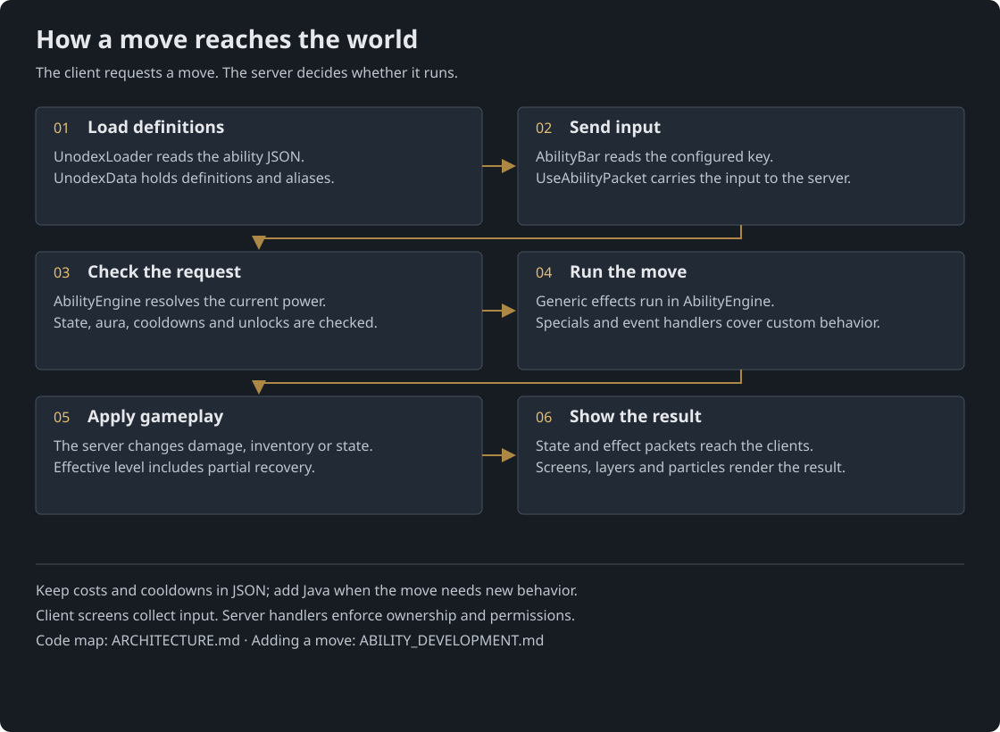
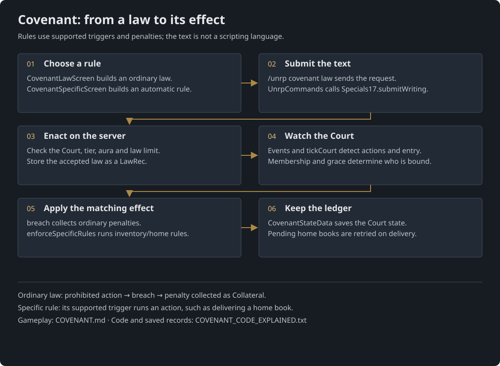
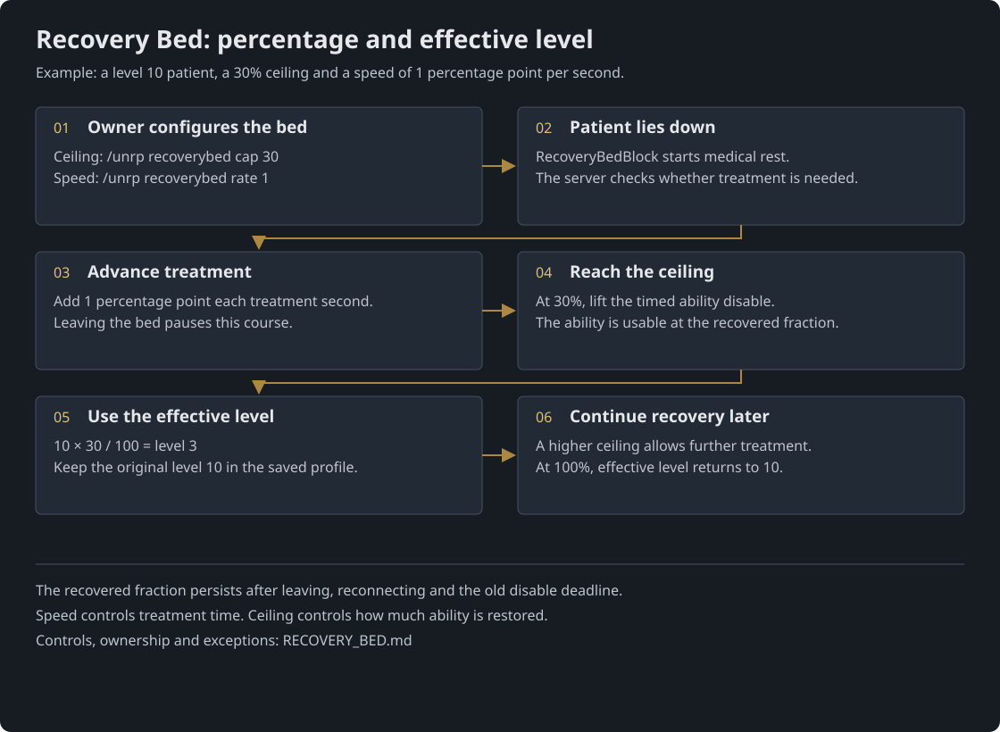

# Working on UNRP

The Forge project is the version we maintain. The Fabric directory is the earlier prototype; gameplay changes belong in `unrp-forge/` unless they specifically concern that prototype.

These notes cover the boundaries that matter when changing the mod. The [file map](<where is what.md>) has the individual paths.

## Follow a move through the project

Start in `ability_powers.json` for costs, cooldowns, prerequisites and existing effects. A new mechanic needs a Java handler as well. `AbilityEngine` handles shared execution; the `Specials` classes and `uo/` event handlers handle behavior that does not fit a generic effect.

The client sends an intention. The server checks whether it is allowed and changes the game state. Keep ownership, costs and inventory checks on that side, even when the screen already hides an unavailable action.

Use `PlayerStateService.effectiveLevel` for runtime checks based on the player's current level. Recovery can reduce that level without changing the saved character sheet. Mastery and progression still need the original profile value.

See [Ability development](ABILITY_DEVELOPMENT.md) for the files and steps involved in adding a move.

## Covenant has two kinds of rule

Ordinary laws prohibit an action and collect a penalty when someone breaks them. Specific rules perform an action directly: transferring signed contracts or delivering a visitor's home coordinates. Both go through the server's Court and tier checks, but their effect handlers differ.

The rule forms produce supported text. They do not interpret arbitrary English instructions. Add a new trigger to the parser and handler before exposing it in a form. Keep the UI choices, tier rules and server validation together when extending the vocabulary.

Most of the runtime still lives in `Specials17`. Smaller helpers cover parsing, limits, inventory transfers and home reports. The [Covenant code guide](COVENANT_CODE_EXPLAINED.txt) maps those classes and the saved records.

## Recovery changes usable strength

The bed has a speed and a ceiling. Speed controls how quickly treatment advances; ceiling controls the fraction of the ability the patient gets back. A level 10 character restored to 30% uses level 3 until further recovery.

Keep the original level in the profile. Store recovery progress with the patient and derive the effective level when it is needed. Completing partial recovery must not turn into full recovery when the patient reconnects or the old disable timer expires.

[Recovery Bed](RECOVERY_BED.md) lists the controls, ownership rules and limits of treatment.

## Keep saves and assets compatible

Resource IDs and saved field names are part of the world's data. Change display text freely, but plan a migration before renaming an identifier that a save already contains. Existing school pieces also retain their saved layout; editing a generator does not rebuild a campus already placed in a world.

Block items inherit their placed models. Clothing previews use the same texture sheets as the worn layers. Keep that connection when changing equipment, and regenerate the preview from the real models. The [visual guide](VISUAL_STYLE.md) lists the asset tools.

## Check the change where it matters

Run `./gradlew build` from `unrp-forge/`. It compiles the mod, runs the Java tests and checks maintained prose for leftover French. Python 3 is required for that language check.

Use the importer checks after changing data import, and the equipment checks after changing model or texture generation. Rendering, hand poses, school terrain and multiplayer interactions still need a game session; a passing build cannot establish that they look or behave correctly in Minecraft.

When updating these docs, describe the current behavior and link its implementation. Keep known limits beside the feature they affect. The SVGs in this page are editable text diagrams; update them with the corresponding guide when a flow changes.
