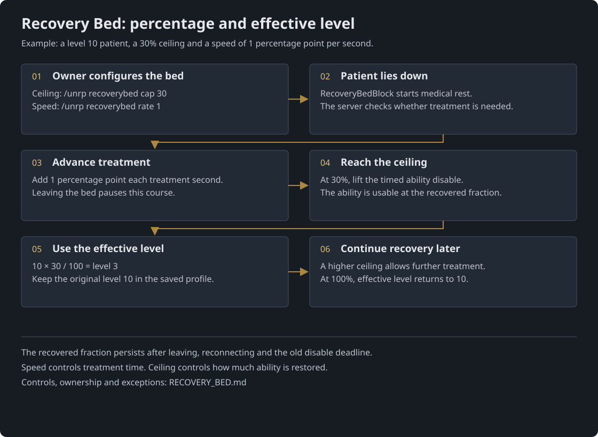

# Recovery Bed

`unrp:recovery_bed` is a two-block machine for restoring a disabled ability. Right-click either half to lie down using Minecraft's synchronized sleeping pose. It does not provide bonus health healing or aura regeneration.

The placing player owns the bed. Only that owner can change its two independent settings:

- **Ceiling**: the fraction of the original ability restored. Default: **50%**. Sneak-right-click with an empty hand cycles 25%, 50%, 75%, 100%. While looking at the bed, `/unrp recoverybed cap 30` sets an exact ceiling between 1% and 100%.
- **Speed**: percentage points recovered per second. Default: 1. `/unrp recoverybed rate 2` changes the speed, without changing the ceiling.

At a speed of 1 and a ceiling of 50%, treatment completes at 50% after 50 treatment seconds. Existing beds without a saved ceiling also default to 50%.

**Effective level = original level × recovered percentage / 100.** A level 10 character restored to 30% plays at level 3; a level 8 character restored to 30% plays at level 2.4. This applies to ability level checks and level-scaled effects as well as the displayed level. The original level remains saved and returns at 100% recovery.

Recovery advances each second while the patient is lying in the bed. At the chosen ceiling, the patient's timed disable is lifted and their ability becomes usable at the restored fraction. Effective level, common move level gates, body stats and aura capacity reflect this partial restoration; the original character/OC profile is not permanently rewritten. It does not automatically activate the power. Use **Leave Bed** to pause treatment; returning resumes progress for the same disable episode. A new disable resets the course. A suspension can also expire naturally before a first course finishes. Once partial restoration completes, its restored fraction persists after leaving the bed, through reconnects and the former suspension deadline; it does not automatically become 100%. A higher-ceiling bed can provide further treatment. Lowering a ceiling does not take away strength already restored, and a ceiling change is not retroactive on someone already fully recovered. Other powers retaining an ability as collateral or actively enforcing suppression are separate constraints: the bed does not steal back collateral or override their authority.

The bed continues working when its owner's source ability is inactive or disabled, so the owner can also recover their own ability. The owner's presence is not required. Owner UUID, source ability and rate are saved in `data/unrp_recovery_beds.dat`; treatment progress is stored with the patient.

Only the owner can break either half, after the source ability is inactive or disabled. Other players cannot modify its rate or break it, including in creative. Explosions, pistons and entities cannot remove it. Beds placed without a source ability retain owner-only controls. Beds placed before ownership support have no recorded owner; ownership cannot be inferred automatically.

Medical rest works by day or night without setting spawn, voting to skip the night, or fading the view to black. It needs two clear blocks and holds one patient. A normal night's sleep by other players may still wake patients.

Get it from the creative tab or `/give @s unrp:recovery_bed`. Recipe: white wool across the top; iron / Recovery Machine / iron in the middle; iron across the bottom.

- `item/RecoveryBedBlock.java`: lying pose and treatment ticks.
- `item/RecoveryBeds.java`: ownership, rates, source-ability binding and destruction checks.
- `item/RecoveryTreatment.java`: percentage progression.
- `ability/AbilityEngine.java`: `hasRecoverableDisable` and `recoverDisabledAbility` connect treatment to the actual suspension state.
- `mixin/RecoveryRestMixin.java`, `RecoverySleepStatusMixin.java`: medical rest without night skipping or sleep fade.
- `tools/design_recovery_bed.py`: real block and item geometry using existing machine textures.
